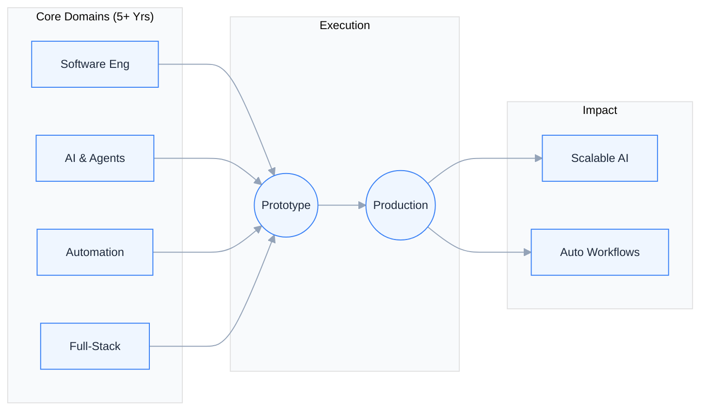

```bash
\$ python deploy.py --engineer "Unaib Bashir" --exp "5+ Years" --role "Forward Deployed Engineer"
> [✓] Software Engineering & Full-Stack Architecture ... ONLINE
> [✓] Agentic Workflows & Enterprise RAG Pipelines ..... ONLINE
> [✓] Intelligent Process & API Automation ........... ONLINE
```



| Domain | Focus Areas | Delivery Mode |
| :--- | :--- | :--- |
| **AI & Agentic Systems** | Enterprise RAG, Multi-Agent Orchestration, Multimodal Vision & Text Pipelines, Guardrails | `Production-First` |
| **Full-Stack Engineering** | Asynchronous APIs, Real-Time Streaming, Scalable Web Portals, Relational & Vector Stores | `End-to-End` |
| **Intelligent Automation** | Event-Driven Workflows, API Integrations, Autonomous Operations, CI/CD & Containerization | `Zero-Friction` |
